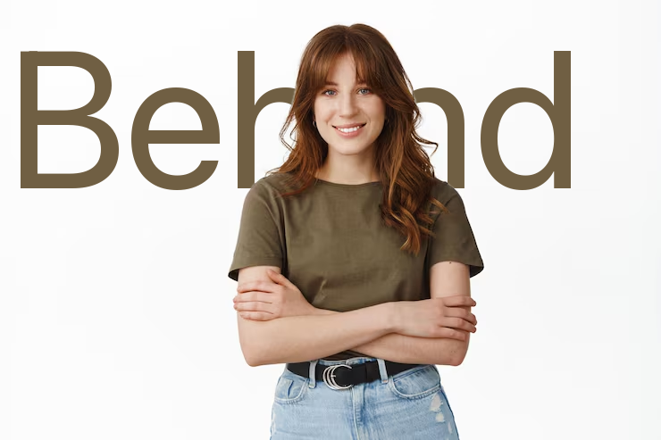
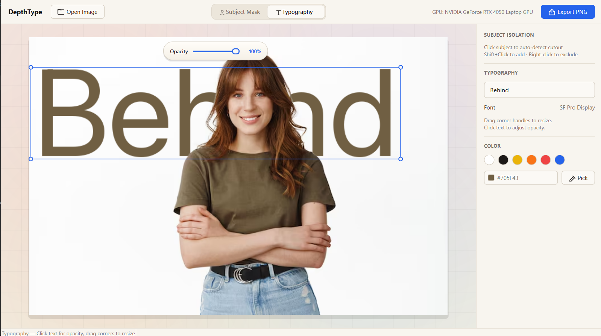
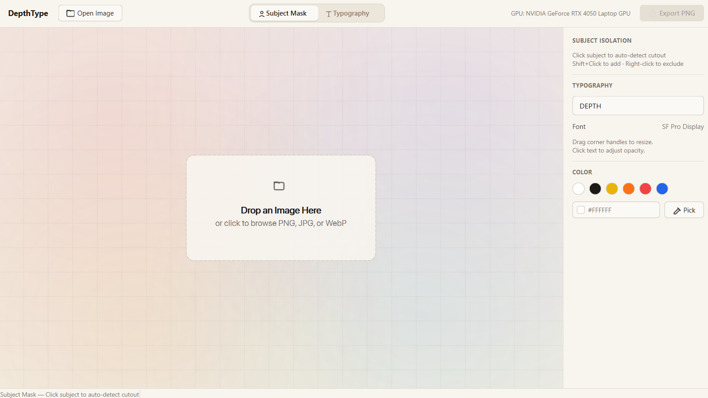

# DepthType

AI-powered depth typography and image compositing desktop application for Windows. DepthType uses Meta's Segment Anything Model 2.1 (`SAM 2.1`) to isolate foreground subjects with a single click and layers high-resolution SF Pro Display typography behind the subject with non-destructive alpha compositing.



---

## Architecture & Compositing Pipeline

DepthType is built in Python using `PySide6` for the desktop interface, `Ultralytics` and `PyTorch` for hardware-accelerated segmentation, and `OpenCV` / `Pillow` for sub-pixel mask refinement and full-resolution image compositing.

### 1. Subject Segmentation (`SAM 2.1`)
- **Interactive Point Prompting:** Left-clicking any foreground subject (people, vehicles, objects) sends normalized image coordinates to `SAM2Predictor` (`sam2.1_b.pt`) with `multimask_output=True`.
- **Whole-Object Mask Selection:** Evaluates predicted IoU confidence scores (`boxes.conf`) and mask area ratios to isolate the primary whole-object mask rather than internal sub-parts.
- **Refinement Controls:** Holding `Shift + Left-Click` appends additional foreground points for multi-part subjects, while `Right-Click` registers negative background exclusion prompts (`label = 0`).
- **Edge Feathering:** Raw binary segmentation logits are bilinearly upsampled to native image dimensions and smoothed via a Gaussian kernel ($\sigma = 1.0$) to prevent aliasing along hair, clothing, and curved object edges.

### 2. Three-Layer Alpha Compositing
Every preview frame and final export is constructed across three distinct RGBA layers:
1. **Base Layer:** Original unscaled RGB source photograph converted to RGBA.
2. **Typography Layer:** Vector-rasterized glyphs rendered via `ImageDraw` using `SF-Pro-Display-Regular.ttf`, supporting real-time coordinate positioning, corner-handle scaling, dynamic alpha opacity (`10%–100%`), and direct pixel color sampling.
3. **Foreground Subject Layer:** Original photograph masked by the feathered 8-bit alpha channel (`mask * 255`), composited via `Image.alpha_composite` above the typography layer.

### 3. Hardware Acceleration
- Automatically detects and initializes `CUDA` (`device=0`) on NVIDIA GPUs, `MPS` on Apple Silicon, or falls back to `CPU` execution.
- High-DPI viewport rendering (`devicePixelRatioF()`) preserves crisp preview scaling without downsampling the underlying export buffer.

---

## Interface & Workflow

| Subject Isolation | Typography & Color Controls |
| :---: | :---: |
|  |  |

- **One-Click Auto-Masking:** Clicking a subject automatically generates the foreground mask, plays an edge contour lift transition, and switches the workspace to Typography mode.
- **Direct Canvas Manipulation:** Drag text freely across the canvas, scale point size proportionally using the 4 corner bounding-box handles, or click the text block to reveal the floating opacity slider.
- **Color Sampling:** Includes preset swatches, an HSB spectrum dialog with hex input, and an integrated eyedropper tool for sampling colors directly from the source photograph.
- **Custom File Browser:** Built-in directory and drive navigator with live image thumbnail previews, resolution metadata, and lossless full-resolution PNG export.

---

## Installation & Running from Source

### Prerequisites
- Windows 10 or Windows 11 (x64)
- Python 3.10 or newer
- NVIDIA GPU with CUDA drivers (optional; falls back to CPU automatically)

### Setup (PowerShell)

1. **Clone the repository:**
   ```powershell
   git clone [https://github.com/PRATHAMTALUKDAR/DepthType.git](https://github.com/PRATHAMTALUKDAR/DepthType.git)
   cd DepthType